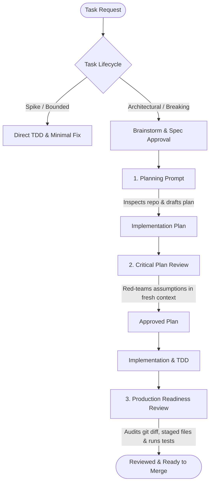

# I Spent 4,500+ Hours Coding with AI. This Is the Claude Code Setup I Ended Up With.

> *The engineering instructions, curated skills, and three-stage review workflow I use to keep AI-assisted development fast, controlled, and verifiable.*

**At a glance**

- **What it is:** one global rules file (`CLAUDE.md`) and three prompts: plan, critique the plan, audit the result.
- **Who it is for:** solo developers and small teams who let an AI agent write real code and want proof, not promises.
- **What it is not:** a framework or an app. It is a few text files plus some optional helpers. The rules are instructions the agent follows, not locks.
- **Evidence:** this is my own working setup. There is no public example project built with it yet.
- **Start here:** [Quick start](#quick-start). Not sure what to type? [Which command, when, and why](#which-command-when-and-why).

---

## Table of Contents

- [Quick start](#quick-start)
- [Which command, when, and why](#which-command-when-and-why)
- [1. The Story Behind This Setup](#1-the-story-behind-this-setup)
- [2. Core Engineering Philosophy](#2-core-engineering-philosophy)
- [3. The Three-Prompt Review Workflow](#3-the-three-prompt-review-workflow)
- [4. Curated Skills & Upstream Attribution](#4-curated-skills--upstream-attribution)
  - [Superpowers (Jesse Vincent)](#superpowers)
  - [Ponytail (Dietrich Gebert)](#ponytail)
  - [I Have ADHD (ayghri)](#i-have-adhd)
- [5. Repository Structure](#5-repository-structure)
- [6. Adoption Guide](#6-adoption-guide)
- [Optional hard gates](#optional-hard-gates)
- [What the community said](#what-the-community-said)
- [7. Credits](#7-credits)

---

## Quick start

For Claude Code. Needs `bash`. Tested on Linux.

```bash
git clone https://github.com/vaibhav-space/my-ai-coding-workflow
cd my-ai-coding-workflow
./install-commands.sh
```

Restart Claude Code and type `/plan`.

The script adds three slash commands, `/plan`, `/review-plan` and `/review-prod`, and copies the plan page template to `~/.claude/plan-template.html`. It skips any file you already have. Pass `--force` to replace files, and it keeps a `.bak` copy.

For the global rules, copy `CLAUDE.md` to `~/.claude/CLAUDE.md` (see the [Adoption Guide](#6-adoption-guide)). If you already have one, merge by hand instead of replacing it.

Using Gemini CLI or Cursor? Copy and paste the prompts from `prompts/` instead.

---

## Which command, when, and why

| You want to... | Type | Why | You get |
|---|---|---|---|
| Fix a typo, or change 1 to 3 files you can name | Just ask. No command. | A plan would cost more than the change. | The change. |
| Build something bigger, or you are not sure how big it is | `/plan` | The agent reads your code and shows a plan before it touches anything. | An interactive plan page with tickable steps. No code is written. |
| Check the plan before you build | `/review-plan` in a **new chat** | A reviewer that did not write the plan has no reason to agree with it. | A verdict, the problems found, and a corrected plan. |
| Check the result before you commit | `/review-prod` in a **new chat** | It reads the real file changes and runs the tests, not the agent's summary. | Proof it works, fixes for what broke, and a "Could not verify" list. |

**The routine, in 5 steps**

1. Type `/plan` and describe what you want. Read the page and tick the steps. Tell the agent what to change.
2. When the plan looks right, say "approved". Nothing is built before that.
3. Open a **new chat**. That means a clean session with no memory of how the plan was made (type `/clear` or start a new session). Paste the plan and run `/review-plan`.
4. Back in your working chat, ask the agent to build the approved plan.
5. Open another **new chat** and run `/review-prod`. Read "Could not verify" first. It tells you what to test by hand.

**Why new chats?** An agent that wrote something is the worst judge of it. A fresh chat has to look at the actual code.

**Good to know**

- The plan page is hosted by your tool (Claude Artifacts, private to you by default). If the plan holds secrets or client data, the prompt asks before publishing. With no Artifact support you get a markdown file with the same sections.
- None of this makes the agent smarter. It makes the agent show its work.

---

## 1. The Story Behind This Setup

This repository is not a speculative prompt collection.

It is the setup I arrived at after spending an estimated **4,500+ hours** actively building, debugging, refactoring, and deploying software alongside AI coding agents.

> [!NOTE]
> *The 4,500+ hours figure is a personal working estimate based on roughly six productive hours per day over a little more than two years of daily engineering work. It is not tracked automated telemetry.*

### The Tooling Journey
My day-to-day workflow evolved across multiple waves of AI developer tooling:
- **Cursor** for inline completions and multi-file agent edits.
- **Claude Code CLI** for autonomous terminal-driven task loops and micro-diff inspections.
- **Antigravity IDE & Gemini CLI** for multi-agent workflows, skill architectures, and background automations.
- **Codex, OpenCode, and Amazon Q**, exploring how different models reason about API contracts, context limits, and tool-calling.

I do not claim equal usage across all these platforms. What became clear through thousands of hours across all of them was a universal pattern:

> **Unconstrained AI coding agents fail predictably.**  
> They suffer from confirmation bias, over-engineer simple utilities into speculative generic frameworks, write code against hallucinated APIs, quietly reformat adjacent files, and declare "tests pass!" without actually executing them.

This repository represents the guardrails, prompts, and behavioral directives I built to reduce those failure modes. It is a practical, personal setup designed for real production work.

---

## 2. Core Engineering Philosophy

| Principle | Why It Matters in AI-Assisted Engineering |
|---|---|
| **1. Correctness Over Speed** | An agent that writes 500 lines in 10 seconds is a liability if 20 of those lines introduce silent race conditions or break API contracts. |
| **2. Simplicity (Ponytail & YAGNI)** | Models reflexively invent factory patterns, wrappers, and speculative abstractions. We enforce the minimal surgical code that solves the problem. |
| **3. Plan Before Implementation** | Forcing an agent to inspect the codebase and write an approved plan first prevents the classic "edit 12 files blindly, break the build, and scramble" loop. |
| **4. Independent Plan Criticism** | An agent reviewing its own plan in the same turn suffers from self-confirmation bias. Plans must be challenged by an adversarial senior-engineering prompt in a fresh context. |
| **5. Diff Inspection Over Summaries** | Never trust an agent's conversational summary of what it did. Audit `git status`, `git diff`, and `git diff --cached`. The diff is the only ground truth. |
| **6. Executable Verification** | Assertions require evidence. An agent must run test suites, reproduction scripts, or dry-runs and output exit codes before claiming completion. |
| **7. Safe Retries & Idempotency** | State-changing operations must have explicit retry semantics and deduplication. In distributed systems and agent loops, replay safety is mandatory. |
| **8. Deterministic Arithmetic** | LLMs must never perform mental math on currency, tax, or markups in text. Mathematical operations are strictly delegated to deterministic code. |
| **9. Scoped Tenant Authorization** | Tools must preserve caller identity and authorization context; agents never execute with ambient root or uncontained privilege. |
| **10. Explicit Blast-Radius Gates** | Schema migrations, public API contract changes, new third-party dependencies, and destructive shell commands require explicit human sign-off. |

Note that the approval gates in `CLAUDE.md` are behavioral instructions the agent follows, not mechanically enforced security boundaries; real enforcement comes from your coding tool's native permission settings.

---

## 3. The Three-Prompt Review Workflow

Rather than allowing an agent to jump straight from user prompt to code editing, non-trivial engineering tasks follow a structured progression:



### Lifecycle Routing
- **`Spike`**: 1 cheap probe command -> 2-sentence finding.
- **`Bounded`**: Covers isolated repairs and 1-3 file non-breaking enhancements. Propose in chat for approval first if altering public API contracts, database schemas, or financial logic; otherwise execute autonomously.
- **`Architectural`**: Subsystems, multi-service features, or breaking contract changes -> Strictly executes the 3-stage review pipeline below.

---

### Stage 1: Planning (`prompts/planning.md`)
- **Job:** Inspect the repository, map requirements to acceptance criteria, and define how each criterion will be verified.
- **Safety Boundary:** Hard instruction: *"Stop once the plan is published and wait for my approval. Do not touch implementation code."*
- **What It Prevents:** Premature code generation against hallucinated file paths, wrong package versions, or incorrect architectural assumptions.
- **Visual Architecture Modeling:** For smaller, direct flows, inline Mermaid diagrams work well. But once an architecture involves multiple services, cross-cutting class dependencies, or evolving business logic, text alone can obscure integration blind spots. In those scenarios, I generate a visual model before locking in an approach. For creating clean, editorial-grade architecture diagrams, I frequently reference Cathryn Lavery's [diagram-design](https://github.com/cathrynlavery/diagram-design).

### Stage 2: Critical Plan Review (`prompts/critical-plan-review.md`)
- **Job:** Act as an independent senior principal engineer red-teaming the plan before a single line of code is written. Run in a **fresh context or subagent** to reduce confirmation bias.
- **Focus:** Identifies race conditions, missing error boundaries, timeout policies, idempotency risks, and over-engineering.
- **Findings or proof:** The reviewer reads the code the plan touches. It lists real problems, or shows exactly what it checked instead of saying "looks solid". Running it on a different model than the one that wrote the plan catches different blind spots.
- **The YAGNI Brake:** Explicitly forces the model to distinguish genuine failure modes from low-probability hypothetical edge cases, stopping speculative complexity before it starts.
- **What It Prevents:** The agent confidently executing an architectural flaw that would require a complete rewrite later.

### Stage 3: Production Readiness Review (`prompts/production-readiness-review.md`)
- **Job:** Audit the raw git state (`git status`, `git diff`, `git diff --cached`, and untracked files) against the approved plan. Run in a fresh context or subagent.
- **Focus:** Hunts for logical bugs, null-pointer boundaries, integration breaks, secrets leakage, and uncommitted artifacts.
- **Evidence rules:** Each check needs the literal command output pasted, or the word BLOCKED. New tests must be shown failing first. One nearby behavior is checked for breakage. After a long session is compacted, the audit runs again from the real diff. It ends with a "Could not verify" list.
- **Remediation Rule:** Fix confirmed issues with the smallest targeted edit. If a fix requires architectural changes or alters public contracts, it must pause and ask first.
- **What It Prevents:** Merging orphaned untracked files, broken staged diffs, weakened test assertions, or cosmetic reformatting regressions.

---

## 4. Curated Skills & Upstream Attribution

Rather than accumulating dozens of overlapping, noisy plugins, this setup incorporates a lean, carefully selected collection of open-source skill packs.

> [!TIP]
> **Global by Design:** `CLAUDE.md` is designed as a global instruction set (used as your global `~/.claude/CLAUDE.md`, or adapted for `GEMINI.md` / agent system prompt) to establish baseline engineering behavior across every project you touch. The three review prompts in `prompts/` are your personal operational templates, used as prompt suffixes during non-trivial tasks rather than committed to client codebases.

### Superpowers
*Repository:* [obra/superpowers](https://github.com/obra/superpowers) by **Jesse Vincent (Obra)**  
*License:* MIT

Jesse Vincent's `superpowers` suite provides foundational process discipline for agentic development:

| Skill | Upstream Runbook | Role in This Setup |
|---|---|---|
| `using-superpowers` | [skills/using-superpowers](https://github.com/obra/superpowers/tree/main/skills/using-superpowers) | Metacontroller establishing workflow discipline at session start. |
| `brainstorming` | [skills/brainstorming](https://github.com/obra/superpowers/tree/main/skills/brainstorming) | Explores user intent, trade-offs, and design before plan authoring. |
| `writing-plans` | [skills/writing-plans](https://github.com/obra/superpowers/tree/main/skills/writing-plans) | Formats structured, measurable implementation plans. |
| `systematic-debugging` | [skills/systematic-debugging](https://github.com/obra/superpowers/tree/main/skills/systematic-debugging) | Enforces 4-step root cause tracing before proposing fixes to bugs. |
| `test-driven-development` | [skills/test-driven-development](https://github.com/obra/superpowers/tree/main/skills/test-driven-development) | Enforces strict Red -> Green -> Refactor cycles for business logic. |
| `verification-before-completion` | [skills/verification-before-completion](https://github.com/obra/superpowers/tree/main/skills/verification-before-completion) | Mandates running terminal verification commands before claiming success. |
| `requesting-code-review` | [skills/requesting-code-review](https://github.com/obra/superpowers/tree/main/skills/requesting-code-review) | Performs automated diff reviews checking spec compliance and scope creep. |
| `finishing-a-development-branch` | [skills/finishing-a-development-branch](https://github.com/obra/superpowers/tree/main/skills/finishing-a-development-branch) | Safely handles branch integration, PR creation, or cleanup without silent merges. |

---

### Ponytail
*Repository:* [DietrichGebert/ponytail](https://github.com/DietrichGebert/ponytail) by **Dietrich Gebert**  
*License:* MIT

AI models inherently generate boilerplate. If you ask for a date utility, they may install `moment.js` or write a generic time-travel class. `ponytail` enforces the **"Lazy Senior Developer"** mindset:
- **The Ponytail Ladder:** `YAGNI -> Existing codebase utilities -> Standard library -> Native platform APIs -> Installed dependencies -> Minimum working code.`
- **Surgical Edits:** Modifies only the lines strictly required to satisfy the request. Unrelated formatting or adjacent refactoring is forbidden.
- **Root-Cause Focus:** Solves problems where callers originate rather than wrapping symptoms downstream.

---

### I Have ADHD
*Repository:* [ayghri/i-have-adhd](https://github.com/ayghri/i-have-adhd) by **ayghri**  
*License:* MIT

This is an **interaction and communication preference**, not a testing or correctness framework:
- **Lead with the Answer:** Direct command, file path, or finding in sentence one.
- **Chunked Information:** Caps bullet lists at 5 items to avoid cognitive overload.
- **Externalized Progress:** Shows `Step X of Y` on multi-step migrations.
- **Zero Conversational Noise:** Eliminates pleasantries, fake time estimates, and motivational closers.

---

## 5. Repository Structure

```text
my-ai-coding-workflow/
├── README.md                      # Architecture, philosophy & attribution
├── CLAUDE.md                      # Master engineering directives (Claude Code & global rules)
└── prompts/
    ├── planning.md                # Stage 1: Codebase inspection & plan draft template
    ├── critical-plan-review.md    # Stage 2: Adversarial plan red-teaming template
    └── production-readiness-review.md # Stage 3: Diff-grounded code & test audit template
```

- **`CLAUDE.md`** is the master reference template for your engineering directives and rules. In Claude Code, place it in your global `~/.claude/CLAUDE.md`. It applies across every project you touch (backend, frontend, microservices) without polluting individual repositories.
Optional helpers, added after community feedback:

```text
├── install-commands.sh            # Installs the 3 prompts as /plan, /review-plan, /review-prod
├── templates/
│   ├── plan-template.html         # Layout the planning prompt uses for the interactive plan page
│   └── gotchas.md                 # Template for mistakes the agent repeats in one repo
└── enforcement/
    ├── settings.example.json      # Example deny rules for risky commands and .env files
    └── pre-commit                 # Git hook that blocks a commit when your tests fail
```

- **`prompts/`** contains the three sequential review prompts. Store them in your personal prompt manager, notes, or IDE snippets to append as prompt suffixes during architectural builds.

---

## 6. Adoption Guide

### Step 1: Set Up Global Directives
Instead of committing configuration files to every project repository, set up `CLAUDE.md` once in your global AI coding agent configuration:

- **Claude Code CLI:** Copy `CLAUDE.md` to your global `~/.claude/CLAUDE.md`.
- **Gemini CLI / Antigravity:** Add these directives to your global `~/.gemini/GEMINI.md`.
- **Cursor:** Paste the directives into Cursor Settings > Rules (User Rules).

Every repository you open will immediately inherit the lifecycle routing, risk approval gates, Ponytail ladder, idempotency, and verification rules.

### Step 2: Use the Three Prompts as Suffixes
Keep the files in `prompts/` in your personal prompt toolkit or snippet manager. When working on non-trivial architectural changes, use them as prompt suffixes:

1. **When planning a feature:** Append the contents of `prompts/planning.md` to your prompt:
   ```text
   <Your task description>
   ---
   <Append prompts/planning.md>
   ```
2. **When red-teaming the plan:** Open a fresh context or subagent, paste the draft plan, and append `prompts/critical-plan-review.md`.
3. **Before merging or completing:** Run a final check by prompting the agent with `prompts/production-readiness-review.md` to audit the raw git diff and verify passing tests.

In Claude Code, `./install-commands.sh` installs these three as `/plan`, `/review-plan` and `/review-prod`, so you do not copy and paste. See the [Quick start](#quick-start).

---

## Optional hard gates

The rules in `CLAUDE.md` are instructions, and an agent can skip instructions. Two small optional files turn the most important rules into locks. Skip them if your employer bans hooks. The prompts work without them.

| File | What it does | Limit |
|---|---|---|
| `enforcement/settings.example.json` | Deny rules for forced pushes, `--no-verify` commits, `rm -rf` and reading `.env` files. Copy the lines you want into your own Claude Code settings. | Rules match the command text. Variants such as `git -C . push` or `git -c ... commit` can slip past. |
| `enforcement/pre-commit` | Blocks a commit when your tests fail. | `git -c core.hooksPath=...` skips it. |

Install the commit gate in one repo:

```bash
cp enforcement/pre-commit .git/hooks/pre-commit && chmod +x .git/hooks/pre-commit
echo "npm test" > .git/workflow-test-cmd   # your own test command; stored inside .git, never committed
```

To remove it, delete `.git/hooks/pre-commit`. Neither file is a security boundary.

---

## What the community said

I posted this setup on [r/ClaudeCode](https://www.reddit.com/r/ClaudeCode/comments/1xw7ylh/i_spent_4500_hours_coding_with_ai_this_is_the/) and asked what to add and what to delete. These parts of the repo came from that feedback.

| Feedback | What changed |
|---|---|
| Markdown rules are only suggestions | Optional [hard gates](#optional-hard-gates) |
| Readiness should say what it could not verify | "Could not verify" list in the readiness prompt |
| "Verified" needs proof, not a claim | Paste literal output or write BLOCKED |
| Tests should fail before they pass, and nearby behavior can break | Both added to the readiness prompt |
| Summaries after a compaction cannot be trusted | Run the readiness audit again after a compaction |
| A reviewer that sees the plan tends to agree with it | Findings or proof, read the code, optional second model |
| The same mistakes repeat in one repo | `templates/gotchas.md` |
| The agent decides what counts as small | Size is judged from the files in the diff |

Not done yet: a progress file with a decision log, an `AGENTS.md` version, and tracking how often the critique finds real problems.

---

## 7. Credits

All upstream skills and referenced tooling belong to their respective creators and are used under their original open-source licenses:
- `superpowers` © Jesse Vincent ([obra/superpowers](https://github.com/obra/superpowers))
- `ponytail` © Dietrich Gebert ([DietrichGebert/ponytail](https://github.com/DietrichGebert/ponytail))
- `i-have-adhd` © ayghri ([ayghri/i-have-adhd](https://github.com/ayghri/i-have-adhd))
- `diagram-design` © Cathryn Lavery ([cathrynlavery/diagram-design](https://github.com/cathrynlavery/diagram-design))

*Built by [Vaibhav](https://github.com/vaibhav-space) through thousands of hours of building real systems with AI agents.*
